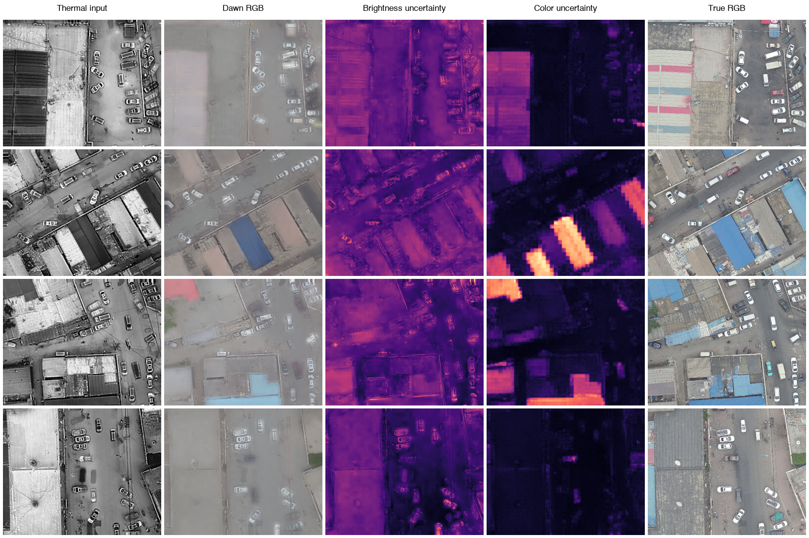
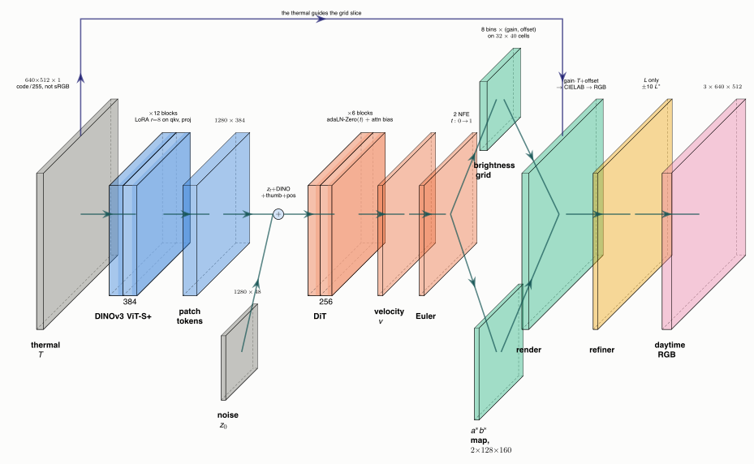
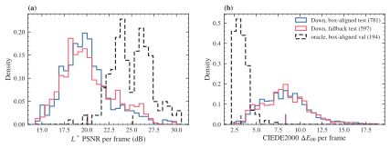
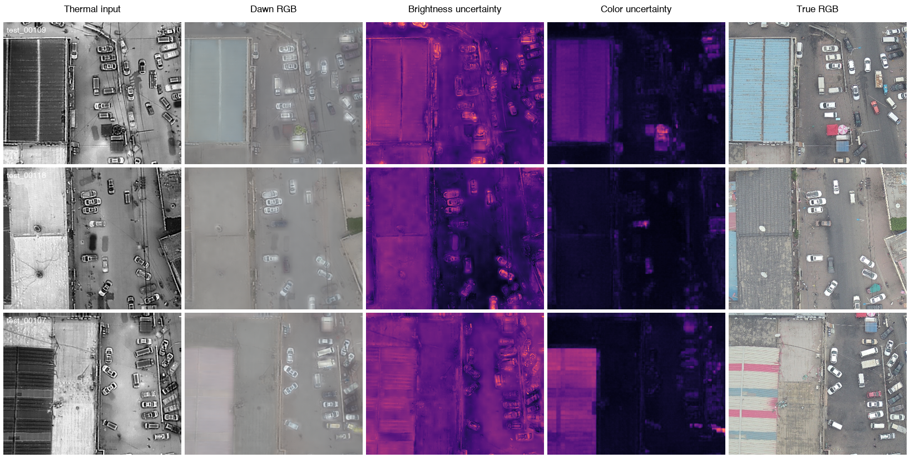
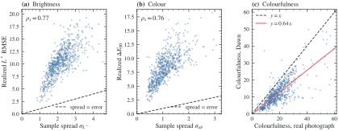
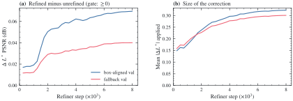
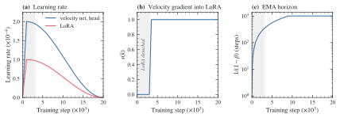
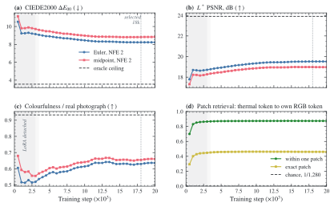
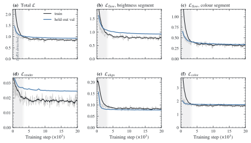
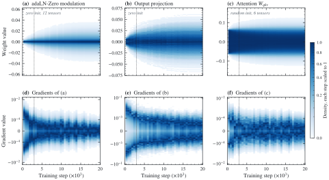

<h1 align="center">Dawn</h1>

<p align="center">
  <b>Day thermal → colour for drone imagery.</b><br>
  A daytime thermal frame goes in. The matching daytime photograph comes out,
  in two network steps, with maps of where the model is unsure.
</p>

<p align="center">
  
  
  
  
  
</p>

<p align="center">
  <a href="#abstract">Abstract</a> ·
  <a href="#2-method">Method</a> ·
  <a href="#5-results">Results</a> ·
  <a href="#6-training-dynamics-what-the-run-did-on-its-own">Training dynamics</a> ·
  <a href="#9-reproducing">Reproducing</a> ·
  <a href="#status">Status</a> ·
  <a href="#8-limitations">Limitations</a>
</p>

<p align="center">
  
</p>

<p align="center">
  <sub><b>Thermal in · Dawn's reconstruction · brightness uncertainty · colour uncertainty · the real photograph.</b><br>
  The reconstruction is visibly paler than the truth. That is the measured 0.64 colourfulness
  reported below. The model hedges toward grey when it cannot tell, and the uncertainty maps
  are brightest in exactly those places.</sub>
</p>

<table align="center">
<tr>
  <td align="center"><b>20.05 dB</b><br><sub>L*&nbsp;PSNR</sub></td>
  <td align="center"><b>8.31</b><br><sub>CIEDE2000</sub></td>
  <td align="center"><b>40 FPS</b><br><sub>at K=8 samples</sub></td>
  <td align="center"><b>ρ = 0.77</b><br><sub>spread vs error, per frame</sub></td>
  <td align="center"><b>5,385</b><br><sub>aligned real pairs</sub></td>
  <td align="center"><b>7.8 M</b><br><sub>generator params</sub></td>
</tr>
</table>

> [!IMPORTANT]
> **Thermal measures heat, not light.** Lane paint, text, signs and the colour of a car have no
> heat signature, so whatever the model puts there is a learned guess, not a measurement.
> Invented detail is accepted here; the *layout* of the scene comes from the thermal image. The
> uncertainty maps show where the model is unsure, not where it is right.

---

## Abstract

Dawn turns a daytime drone thermal frame (640×512, one channel) into the matching daytime colour
photograph in **two velocity-network evaluations**, with per-pixel brightness and colour
uncertainty. Brightness is not generated as pixels: it is an affine bilateral grid of thermal
intensity (per 16×16 cell and per intensity bin, a gain and an offset), and the best such grid
fitted to the real photograph (the *oracle*) already reaches 25.1 dB L\* PSNR. What is generated,
by a 7.8M-parameter flow-matching transformer conditioned on a LoRA-tuned DINOv3 ViT-S+, is that
grid's coefficients and a 128×160 a\*b\* colour map; the image is assembled in CIELAB. On **781
held-out box-aligned DroneVehicle pairs** the model reaches **20.05 dB L\* PSNR and 8.31
CIEDE2000**, against a ceiling of 25.13 dB and 3.25, and runs at **40 FPS with eight uncertainty
samples** on an RTX 5090. Its sample spread ranks test frames by their real error (Spearman
ρ = 0.77) but understates it about 5×, and its colour reaches 64% of the photograph's
colourfulness: the model has collapsed toward the conditional mean.

The most interesting thing the run did by itself is in its **attention gates**: six scalars,
initialised at zero, that decide how strongly each generator block follows DINO's own attention.
All six opened, two of them nearly fully (0.94 and 0.85); one opened and then **closed again**
as soon as the encoder began to receive the generator's gradient; and on 100 memorised frames
none of them opened much ([Section 6.1](#61-the-attention-gates-opened-themselves)).

<details>
<summary><b>Contents</b></summary>

1. [The problem](#1-the-problem)
2. [Method](#2-method): brightness grid, colour map, tokens, flow matching, gated DINO attention, objective, schedule, uncertainty, refiner
3. [Data](#3-data)
4. [Experimental setup](#4-experimental-setup) and the campaign's gates
5. [Results](#5-results): ceiling, test metrics, the gap, vehicles, uncertainty, colour, refiner, speed
6. [Training dynamics](#6-training-dynamics-what-the-run-did-on-its-own): attention gates and their gradients, schedule, validation, losses, weight and gradient distributions, convergence
7. [Findings and limitations](#7-findings-and-limitations)
8. [Reproducing](#8-reproducing): install, data, oracle, training, the campaign, inference, the figures
9. [Project structure](#9-project-structure)
10. [Status](#status) · [References](#references) · [Citation](#citation) · [License](#license)

</details>

---

## 1. The problem

Input: a daytime thermal frame $`T \in [0,1]^{H\times W}`$ (the camera's 8-bit codes / 255,
never gamma-converted). Output: the paired daytime photograph $`y`$ (linear RGB). The two
cameras are a few centimetres apart and expose at slightly different times, so training pairs
are only as good as their alignment ([Section 3](#3-data)).

Two observations shape the whole design:

1. **Brightness is mostly a function of thermal intensity, locally.** Asphalt, roofs and
   vegetation each have a fairly stable relation between how warm they are and how bright they
   look, but that relation changes across the frame. A per-region curve of thermal can therefore
   explain most of the lightness, and how much it explains can be *measured* before any model is
   trained (the oracle, [Section 5.1](#51-the-ceiling)).
2. **Colour is ambiguous.** Nothing in a heat image says whether a car is red or blue. A
   regressor averages the possibilities into grey-brown; a generative model can commit to one
   plausible answer. Colour is the half that gets the generative machinery.

| Symbol | Meaning | Value |
|---|---|---|
| $`H, W`$ | input size (`encoder.input_size`) | 512 × 640 |
| $`g_y, g_x`$ | token / brightness-cell / DINO-patch grid, $`(H, W)/16`$ | 32 × 40 |
| $`N`$ | tokens, $`g_y g_x`$ | 1,280 |
| $`K`$ | thermal-intensity bins of the brightness grid | 8 |
| $`D`$ | values per token, $`2K + 2\cdot 4^2`$ | 48 |
| $`Q`$ | quantised a\*b\* bins (occupied cells of the sRGB gamut) | 261 |
| $`L`$ | lightness the grid predicts, $`L = L^\ast/100`$ | $`[0, 1]`$ |
| $`t`$ | flow time, 0 = noise, 1 = data | $`[0, 1]`$ |

Every layout, unit and coordinate convention is fixed in code: `dawn/flow/tokens.py` owns the
token layout, `dawn/grid/` the brightness grid, and `dawn/flow/render.py` is the single render
path.

---

## 2. Method

### 2.1 Overview

<p align="center">
  
</p>

**Figure 1.** Left tower: the frozen DINOv3 encoder, LoRA on qkv and the output projection. Right
tower: the generator, 6 DiT blocks where adaLN-Zero injects the flow time and residuals are
*gated*, so a fresh block is the identity. Blue marks the two conditioning routes: patch tokens
**added** to the input tokens, and DINO's last-layer attention entering every block as a logit
bias behind a per-block gate starting at 0. Above the generator: two Euler steps, the unpack, the
CIELAB render, and the optional refiner on $`L`$ alone.

One frame costs **one** DINO pass and $`\text{NFE}\times K`$ velocity passes (2x8 at inference), the main
structural bet ([Section 5.8](#58-speed)).

### 2.2 Brightness: an affine bilateral grid on thermal

Guidance $`g`$ is the thermal after a 5x5 box blur with replicate padding, clamped to $`[0, 1]`$ (no log,
no contrast stretch). The grid holds a gain $`a_n`$ and offset $`b_n`$ at every node
$`n = (k, i, j)`$: intensity bin, cell row, cell column, on a 32x40 grid of 16x16 cells. Each pixel
reads its 8 surrounding nodes with trilinear weights $`w_n(p)`$ at cell *centres*, so lightness is
affine in thermal with coefficients varying smoothly in space and intensity:

```math
\hat L(p) = \mathrm{clamp}\Big(\sum_{n \in \mathcal N(p)} w_n(p)\,\big[a_n\,T(p) + b_n\big],\ 0,\ 1\Big),
\qquad \hat L^\ast(p) = 100\,\hat L(p).
```

A bilateral grid (Chen et al., 2007; Gharbi et al., 2017) with one-channel input and
$`L = L^\ast/100`$ out. Targets are fitted per image on GPU with no gradient: each node is a weighted
ridge regression against the pixels touching it, pulled toward its cell's fit so sparse bins stay
sane, then one refinement pass fits the render residual (`dawn/grid/fit.py`).

### 2.3 Colour and assembly in CIELAB

Colour is a generated a\*b\* map (128x160, a 4x4 block per token), upsampled **bilinearly** and
combined with the grid's lightness:

```math
\hat y = \mathrm{clip}_{[0,1]}\Big(\mathrm{Lab}^{-1}\big(100\,\hat L,\ \mathrm{Up}(A)\big)\Big).
```

The plan specified bilateral guided upsampling; it lost at every grid swept, whole-frame and at
edges alike, because its per-cell affine model of colour on $`L`$ smooths away colour that is not a
function of $`L`$. One render path, `dawn/flow/render.py`, serves `L_render`, validation, the
oracle and inference.

### 2.4 One token per DINO patch

Brightness cells, DINO patches and generator tokens are the same 32x40 grid. Token
$`n = i\,g_x + j`$ carries everything generated for its patch:

```math
x_n = \big[\underbrace{a_{0,n},\, b_{0,n},\, \dots,\, a_{K-1,n},\, b_{K-1,n}}_{2K = 16\ \text{brightness}}\ \big|\
\underbrace{a^\ast_{n,1..16},\ b^\ast_{n,1..16}}_{32\ \text{colour: its}\ 4\times 4\ \text{block}}\big] \in \mathbb{R}^{48},
```

standardised per *segment*, so a bin-0 and a bin-7 offset never share a mean. `dawn/flow/tokens.py`
is the only place that packs or unpacks this.

### 2.5 Flow matching

A conditional rectified flow (Lipman et al., 2023; Liu et al., 2023) on the standardised tokens,

```math
z_t = (1 - t)\,z_0 + t\,z_1, \qquad z_0 \sim \mathcal N(0, I), \qquad t \sim \mathcal U[0, 1],
```

with $`v_\theta`$ regressing the straight-line velocity:

```math
\mathcal L_\text{flow} = \sum_{s\,\in\,\{\text{bri},\,\text{col}\}} \frac{D_s}{D}\;
\mathbb{E}\Big[\,\overline{\omega_s \odot \big(v_\theta(z_t, t, c) - (z_1 - z_0)\big)^{2}}\,\Big],
\qquad D_\text{bri} = 16,\ D_\text{col} = 32.
```

$`\omega`$ is the masked pixel count behind each brightness node and the kept fraction of each colour
pixel, normalised to mean 1 per segment, so a node nobody saw does not count. Inference takes two
Euler steps of $`\tfrac12`$, unstandardises once, unpacks and renders.

### 2.6 The conditioning: LoRA-DINOv3 and gated attention

**Encoder.** DINOv3 ViT-S+/16, 28.7M parameters, frozen; thermal copied to three channels. Every
block's qkv and output projection carries a rank-8 LoRA adapter (Hu et al., 2022), 0.22M
trainable parameters in 24 modules, zero-initialised so step 0 is exactly the pretrained encoder.
Out come 1,280 patch tokens and the last layer's patch-to-patch attention $`A`$ (heads averaged,
CLS and registers stripped, rows renormalised, detached).

**Velocity net.** Six DiT blocks (Peebles & Xie, 2023), width 256, 4 heads, 7.82M parameters.
Each token's input embedding sums four terms: its noised tokens, the DINO patch feature, the
thermal area-averaged to 32x40, and a learned position embedding. Time enters each block by
adaLN-Zero from a zero-initialised projection, so every block starts as the identity.

**Gated DINO attention.** DINO's attention is an additive logit bias per block, scaled by one
learned scalar **initialised at 0**:

```math
\mathrm{Attn}_\ell(Q, K, V) = \mathrm{softmax}\!\Big(\frac{QK^{\top}}{\sqrt d} + g_\ell\,\log(A + \epsilon)\Big)\,V,
\qquad g_\ell^{(0)} = 0,\ \ \epsilon = 10^{-6}.
```

Because the bias is a *log*, $`g_\ell`$ is an exponent on DINO's attention: at 0 the block ignores
DINO, at 1 the two attentions multiply, in between the prior is tempered. $`A`$ is detached, so no
gradient reaches the encoder this way, but the gate always gets one and carries no weight decay.
Nothing forces a gate open ([Section 6.1](#61-the-attention-gates-opened-themselves) shows what it
chose).

### 2.7 Training objective

Four terms, all masked so invalid warp pixels and moving vehicles never contribute:

```math
\mathcal L = \mathcal L_\text{flow} + 0.1\,\mathcal L_\text{render} + 0.5\,\mathcal L_\text{align} + 0.2\,\mathcal L_\text{color}.
```

**Render** is a masked L1 in CIELAB between the photograph and the one-step estimate
$`\hat z_1 = z_t + (1-t)\,v_\theta`$, rendered at 256x320; fallback-aligned pairs ([Section 3](#3-data)) count
half. **Align** is $`1 - \cos`$ between the adapted encoder's thermal patch tokens and the frozen
encoder's tokens on the paired RGB, weighted by each patch's kept fraction. **Colour** is a
cross-entropy from a linear head on each adapted patch token against the patch's soft a\*b\*
histogram over the 261 bins (Zhang et al., 2016), counted only for patches at least half
unmasked. The last two train LoRA and the head only; the head is discarded at inference.

### 2.8 Schedule: detach, then ramp

For 3,000 steps the encoder's patch tokens reach the velocity net **detached**, so LoRA learns
from the align and colour terms alone; the velocity gradient is then eased in linearly over 500
steps rather than switched on, leaving the forward pass untouched. AdamW, peak LR 2e-4 (1e-4 for
LoRA), 1,000 steps linear warmup then cosine to zero at 20,000, clip 1.0, bf16. The validation EMA
warms up from 0.1 to 0.999, so early validations measure trained weights rather than the
initialisation. One encoder pass feeds 8 timesteps, so a step of 16 images is 128 velocity samples
([Section 6.2](#62-the-schedule)).

### 2.9 Uncertainty from samples

$`K`$ noises give $`K`$ renders from **one** encoder pass. The maps are their spread, on rendered
L\*a\*b\* and never on tokens, unbiased:

```math
\sigma_{L^\ast}(p) = \sqrt{\tfrac{1}{K-1}\textstyle\sum_{k}\big(L^{\ast}_{k}(p) - \bar L^{\ast}(p)\big)^{2}},
\qquad
\sigma_{ab}(p) = \sqrt{\mathrm{Var}_k\,a^{\ast}_{k}(p) + \mathrm{Var}_k\,b^{\ast}_{k}(p)} .
```

$`\sigma_{ab}`$ is a chroma distance on the same scale as a CIEDE2000, so the two can be ranked against
each other. No variance head, no calibration target: a spread is a *disagreement*, not an error
bar ([Section 5.5](#55-uncertainty-measured)). Display one member, not the ensemble mean.

### 2.10 Stage 2: the local refiner

An optional 2,545-parameter depthwise-separable CNN on lightness only, 9x9 receptive field (far
smaller than a vehicle), bounded as $`L' = L + 0.1\tanh(r_\psi(L, T))`$ so it can sharpen but not invent.
It trains on the *fitted* grid's $`L`$ and meets the *generated* one at inference; that mismatch is
what lets stage 2 train before stage 1 exists. Colour is untouched, and without `--refiner`
inference is byte-identical to stage 1.

## 3. Data

Real thermal/RGB pairs from **DroneVehicle** (Sun et al., 2022;
[McCheng/DroneVehicle](https://huggingface.co/datasets/McCheng/DroneVehicle)): 840×712 frames with
a 100-px white border, five vehicle classes boxed *separately* in each modality. The box centres
give cross-modal correspondences without any feature matching.

| Stage | train | val | test | total |
|---|--:|--:|--:|--:|
| stems in the image folders | 17,990 | 1,469 | 8,980 | 28,439 |
| paired and readable | 17,951 | 1,469 | 8,980 | 28,400 |
| day (median linear luminance of the RGB ≥ 0.20) | 5,818 | 532 | 2,184 | 8,534 |
| aligned (geometry and edge checks) | 3,662 | 346 | 1,380 | 5,388 |
| **final** (val/test near-duplicates of train dropped) | **3,662** | **345** | **1,378** | **5,385** |

A pair is aligned one of two ways. **Box-aligned** (3,011): same-class boxes are matched as mutual
nearest neighbours, a similarity transform is fitted by RANSAC (a homography only when the
similarity's residual alone fails), and the pair is accepted only with ≥ 6 matches, inlier ratio
≥ 0.6, median residual ≤ 2 px, scale within 5%, rotation under 2° and shift under 30 px, then
checked independently by gradient-magnitude correlation. **Fallback** (2,374): where the boxes
cannot judge (copied labels, too few vehicles), a global translation from the same edge
correlation, accepted only with one clear peak and agreeing image quadrants. Against box-fitted
pairs that estimate is within 2 px 86% of the time.

The thermal is warped onto the RGB frame (the RGB is never resampled) and every pair carries a
pixel mask

```math
m = \begin{cases} \mathtt{valid} \wedge \neg\,\mathtt{moving}, & \text{box-aligned},\\
\mathtt{valid} \wedge \neg\,\mathtt{vehicles}, & \text{fallback},\end{cases}
```

where `valid` removes pixels the warp pulled from outside the thermal frame, `moving` removes
vehicles whose own residual says they moved between the exposures, and `vehicles` (for fallback
pairs, where nothing is known about motion) masks every vehicle, stretched 17.4 px along its
heading where it may have moved: 12% of a frame on average. Counts at every stage land in `data/manifests/logs/summary.md` when the pipeline runs
([Section 8.2](#82-data)).

---

## 4. Experimental setup

| | |
|---|---|
| Hardware | **RTX 5090** (32 GB) on an AMD EPYC 7C13 64-core host with 129 GB RAM, 8 October 2026 |
| Trainable parameters | velocity 7.82M · LoRA 0.22M · colour head 0.10M = **8.14M** (of 36.8M) |
| Batch | 16 images × 8 timesteps = 128 velocity samples per step; `L_render` on a random 64 of them |
| Budget | 20,000 steps = 229 steps/epoch × **87.4 epochs**; detached for the first 13.1 epochs |
| Speed | **0.40 s/step** median, **17.1 GB** peak, 2.5 h wall clock including validation |
| Validation | every 500 steps on 64 box-aligned and 64 fallback val pairs, EMA weights, NFE 2, Euler and midpoint |
| Model selection | lowest CIEDE2000 on box-aligned val (`logging.select_metric`), not L\* PSNR, which is mostly the thermal-fitted grid and blind to colour going wrong |
| Test | 1,378 test pairs, reported separately for 781 box-aligned (the headline) and 597 fallback |
| Config | [`configs/flow.yaml`](configs/flow.yaml) + [`configs/gpu_5090.yaml`](configs/gpu_5090.yaml), saved with every run as `run_config.json` |
| Telemetry | every logged metric is mirrored beside the run as CSV and JSONL; the copies in [`results/`](results/) are what this page is built from |

### The campaign and its gates

The run is one command, `scripts/run_pipeline.py --yes` ([Section 8.5](#85-the-whole-campaign-one-command)),
and each stage is a gate for the next. A failed gate stops the campaign with a message that says
what to do.

| Stage | What it checks | Measured | Rule | Wall clock |
|---|---|---|---|--:|
| `gpu_probe` | VRAM and s/step of the real config, 50 steps | 17.1 GB, 0.41 s/step | fits in 32 GB | 3.6 min |
| `smoke_dino` | real weights, shapes, LoRA targets, `B = 0` at init | 24 LoRA modules, 0.22M trainable | passes | 9 s |
| `oracle` | can a brightness grid explain lightness at all? | **25.08 dB** on 345 val pairs | ≥ 24 dB | 54 s |
| `overfit` | can the model memorise 100 frames? | **23.11 dB** against their 26.06 dB oracle (88.7%) | ≥ 85% | 27 min |
| `baseline` | the real run | best at step 18,000 | | 2.5 h |
| `refiner` | does stage 2 help? | **+0.070 dB** over the unrefined grid | ≥ 0 | 8.8 min |
| `evaluation` | the test split | [Section 5.2](#52-test-results) | | 4.2 min |

All seven passed: **3.2 h end to end**. The record is
[`results/pipeline_state.json`](results/pipeline_state.json).

---

## 5. Results

### 5.1 The ceiling

`scripts/check_oracle.py` fits the best possible grid and colour map to each real val pair and
renders them with the same code the trainer uses. These are the **best any model of this shape
could do**, not results ([`results/oracle/report.md`](results/oracle/report.md), 345 val pairs):

| | all (345) | box-aligned (194) | fallback (151) |
|---|--:|--:|--:|
| grid only, L\* PSNR, refine 0 / **1** | 24.60 / **25.08** | 24.61 / **25.13** | 24.58 / 25.02 |
| grid + generated 128×160 L correction, refine 1 | 26.85 | 27.04 | 26.60 |
| colour ceiling, mean $`\lvert\Delta a^\ast b^\ast\rvert`$, bilinear / BGU | **0.90** / 1.28 | 0.86 / 1.23 | 0.94 / 1.34 |
| … at edges (top 10% of gradient magnitude), bilinear / BGU | **1.45** / 2.37 | 1.39 / 2.30 | 1.51 / 2.45 |
| assembled oracle, grid only, bilinear colour, CIEDE2000 | **3.33** | **3.25** | 3.43 |
| assembled oracle, with correction, CIEDE2000 | 2.77 | 2.66 | 2.91 |

The grid alone clears the plan's 24 dB decision rule, so brightness really is a regional curve of
thermal intensity on this data; that was the design's central bet, settled before a single step
was trained. Box-aligned and fallback pairs have the **same** ceiling: loose alignment does not
make a pair harder to *fit*, only harder to *learn from*. The oracle is measured on val, not test,
so the test numbers below are read against the box-aligned val ceiling.

### 5.2 Test results

Box-aligned test pairs, NFE 2, K = 8 samples, best checkpoint (step 18,000, EMA). L\* PSNR has its
peak at 100 and is masked like the losses; LPIPS (AlexNet) is whole-frame and unmasked.
([`results/evaluation/report.md`](results/evaluation/report.md): p10/p50/p90 for every row.)

| | Euler (default) | midpoint | fallback pairs, Euler | ceiling |
|---|--:|--:|--:|--:|
| frames | 781 | 781 | 597 | |
| **L\* PSNR**, dB ↑ | **20.05** | 19.38 | 20.11 | 25.13 |
| **CIEDE2000** ↓ | **8.31** | 8.98 | 8.37 | 3.25 |
| SSIM on L\* ↑ | **0.556** | 0.543 | 0.552 | |
| LPIPS ↓ | **0.535** | 0.543 | 0.532 | |
| colourfulness, output / photo | 11.99 / 18.63 = 0.64 | 12.48 / 18.63 = **0.67** | 0.61 | 0.93 |
| ensemble mean of 8: PSNR / CIEDE2000 | 20.28 / 8.04 | 19.87 / 8.43 | 20.31 / 8.16 | |
| sample spread $`\sigma_{L^\ast}`$ / $`\sigma_{ab}`$ | 2.18 / 1.10 | 3.40 / 1.63 | 2.28 / 1.08 | |

<p align="center">
  <picture>
    <source media="(prefers-color-scheme: dark)" srcset="docs/images/plots/test_distributions_dark.svg">
    
  </picture>
</p>

<p align="center"><sub><b>Figure 2.</b> One value per frame. Box-aligned and fallback test frames are
indistinguishable, and no cluster of catastrophic failures is concealed by the mean (PSNR p10
16.99, p90 23.89). The dashed distribution is the oracle on box-aligned val frames.</sub></p>

The best decile nearly touches the ceiling (CIEDE2000 p10 5.07 against 3.25); the average is
dragged by the hard decile at 11.56. Fallback pairs, carried at half weight in `L_render` and kept
out of model selection as a precaution, score the same as box-aligned ones, so the 44% of the data
aligned by edge correlation alone was free.

<p align="center">
  
</p>

<p align="center">
  <sub>Three of the best frames. Every test frame, in the same layout:
  <a href="docs/images/sheets/all_test_frames.png"><code>docs/images/sheets/all_test_frames.png</code></a>.</sub>
</p>

### 5.3 Where the 5 dB gap comes from

The overfit gate trains the same model on 100 frames and validates on 16 of them: whatever gap
remains on frames it has *memorised* cannot be generalisation, so it is structural (a 2-step
generation from noise cannot reproduce an exactly-fitted grid). The rest is generalisation:

```math
\underbrace{25.13 - 20.05}_{5.08\ \text{dB, test}}
\;\approx\;
\underbrace{26.06 - 23.11}_{2.96\ \text{dB on memorised frames: structural}}
\;+\;
\underbrace{2.12\ \text{dB}}_{\text{generalisation}} .
```

This is a decomposition, not a measurement on one set of frames (the two gaps are measured on
different frames), so read it as "about 3 dB structural, about 2 dB generalisation". It is the
reason the overfit gate exists.

### 5.4 Vehicles are the weak point, as predicted

| box-aligned test, Euler | whole frame | vehicle region |
|---|--:|--:|
| L\* PSNR, dB | 20.05 | **16.44** |
| CIEDE2000 | 8.31 | **12.54** |
| SSIM | 0.556 | **0.374** |

About 50% more colour error on the objects a drone application cares about most. Thermal
carries no paint, so a red car and a blue car are the same input and the model paints the
statistically likely colour. The vehicle region is the `vehicles` mask (every vehicle, dilated);
it exists only for box-aligned pairs in this evaluation, so the fallback rows of `report.md`
(140 dB, 0.000) are placeholders for an empty region, not results.

### 5.5 Uncertainty, measured

<p align="center">
  <picture>
    <source media="(prefers-color-scheme: dark)" srcset="docs/images/plots/per_frame_dark.svg">
    
  </picture>
</p>

<p align="center"><sub><b>Figure 3.</b> One point per box-aligned test frame (781). Left and middle:
the frame's mean sample spread against its realized error. Right: colourfulness of Dawn's output
against the photograph's.</sub></p>

Per frame, the spread **ranks** the error well: Spearman ρ = 0.77 between $`\sigma_{L^\ast}`$ and
the frame's L\* RMSE, and 0.76 between $`\sigma_{ab}`$ and its CIEDE2000 (0.77 and 0.67 on fallback
frames). It does not **scale**: the mean RMSE is 10.45 L\* against a mean spread of 2.18, so the
model's disagreement with itself is about **a fifth** of how wrong it is. Midpoint sampling ranks
slightly better (ρ = 0.83) and understates less (3.3×), because one large step from noise keeps
more of the noise. A per-frame correlation is weaker evidence than a per-pixel one; the per-pixel
rank correlation and calibration curve in `dawn/eval/calibration.py` exist but were not part of
this evaluation.

### 5.6 One thread ties the weaknesses together

| | |
|---|---|
| sample spread $`\sigma_{L^\ast}`$ | 2.18 L\*: the eight members barely differ |
| ensemble mean vs one member | PSNR +0.23 dB, CIEDE2000 −0.28: averaging changes almost nothing |
| colourfulness | 64% of the photograph where the ceiling is 93% and the overfit run reached 83% |

Three numbers that look independent are one phenomenon: **the model has collapsed toward the
conditional mean**. It behaves like a regressor emitting one safe answer rather than a generator
drawing from a distribution of plausible colourings; if its samples were more diverse, their
spread would be larger *and* averaging them would help far more than 0.23 dB. The duller end of
the distribution is where it shows most (output p10 colourfulness 4.08 against the photographs'
8.84), which is what defaulting to grey when the signal is weak looks like. Flow matching was
chosen to avoid exactly this. The model is useful regardless, but on this evidence the generative
machinery is not yet earning its keep over a simpler direct predictor, and that is the single most
interesting finding of the run.

### 5.7 The refiner

<p align="center">
  <picture>
    <source media="(prefers-color-scheme: dark)" srcset="docs/images/plots/refiner_dark.svg">
    
  </picture>
</p>

<p align="center"><sub><b>Figure 4.</b> Stage 2 over its 8,000 steps (fp32, 0.06 s/step), on 64 val pairs
per subset with the <i>fitted</i> grid as input.</sub></p>

The refiner passed its gate: **+0.070 dB** on box-aligned val (23.909 → 23.978 dB) and +0.040 on
fallback, moving lightness by 0.32 L\* on average, and flattening as its learning rate reached zero. That is
a real but small sharpening, and it was measured on the fitted grid. Whether it survives the
generated grid, which is 5 dB worse, is **not measured**: the headline numbers above are stage 1
alone.

### 5.8 Speed

`scripts/benchmark_latency.py`, RTX 5090, 640×512, NFE 2, K = 8:

| component | GMACs | ms |
|---|--:|--:|
| encoder (DINOv3 + LoRA), **once** | 52.3 | 14.25 |
| velocity × 2 NFE × 8 samples | 179.7 | 8.85 |
| render (slice, upsample, Lab) | 0.06 | 1.88 |
| **total per frame** | **232.1** | **24.98 → 40 FPS** |

The encoder is 57% of the cost and runs once per frame regardless of $`K`$; at $`K = 1`$ a frame
costs about 17 ms (58 FPS).

---

## 6. Training dynamics: what the run did on its own

Everything in this section is rebuilt from [`results/`](results/) by `python scripts/plot_runs.py`,
which also writes every number quoted here to
[`docs/images/plots/numbers.json`](docs/images/plots/numbers.json). The curves come from the
per-step CSV mirrors. The weight and gradient histograms (Figure 5c, Figure 9) are the ones
`wandb.watch` recorded for the velocity net (64 bins; weights at 51 snapshots, gradients at 40,
every 400 to 500 steps), extracted from the run's local log into `results/baseline/histograms.npz`.

### 6.1 The attention gates opened themselves

<p align="center">
  <picture>
    <source media="(prefers-color-scheme: dark)" srcset="docs/images/plots/gates_dark.svg">
    
  </picture>
</p>

<p align="center"><sub><b>Figure 5.</b> (a) The six DINO-attention gates g<sub>ℓ</sub> of Section 2.6, logged
every 100 steps (live weights), coloured by depth. Dark band: LoRA detached from the velocity loss;
light band: the 500-step ramp. (b) The same gates in the overfit gate's run (100 frames, 3,000
steps). (c) The gradient on each gate, −∂L/∂g<sub>ℓ</sub>, one training batch per column on a
symmetric-log colour scale: blue means a descent step opens the gate, red that it closes it.
Dashed line: the detach lifts; dotted line: g<sub>5</sub> peaks.</sub></p>

The gates start **closed**, at exactly zero, with no pressure to open: the generator could have
trained to the end ignoring DINO's attention entirely. It did not.

| block $`\ell`$ | 0 | 1 | 2 | 3 | 4 | 5 |
|---|--:|--:|--:|--:|--:|--:|
| at step 3,000 (detach lifts) | 0.14 | 0.52 | 0.27 | 0.37 | 0.54 | 0.49 |
| final, step 20,000 | 0.42 | **0.85** | 0.55 | 0.50 | **0.94** | **0.31** |
| overfit run, final (3,000 steps) | 0.13 | 0.24 | 0.16 | **0.35** | 0.12 | 0.19 |

Four things stand out:

1. **They opened while the encoder was detached.** By step 3,000, while no velocity gradient had
   yet reached LoRA, five of the six gates were already between 0.27 and 0.54. This is possible
   because the gate's gradient (Section 2.6) flows through the *detached* bias $`\log(A + \epsilon)`$: the
   generator was learning to use DINO's attention as a fixed prior before it could shape DINO's
   features.
2. **Two blocks went nearly all the way.** $`g_4 = 0.94`$ and $`g_1 = 0.85`$ are close to the product
   of experts at $`g = 1`$: in those blocks the generator's attention is, in effect, its own
   multiplied by DINO's.
3. **One block opened and then closed.** $`g_5`$ rose with the others to **0.51 at step 3,900**,
   400 steps after the ramp finished at 3,500, and then fell for the rest of the run to 0.31. Over
   the same transition the encoder's gradient norm rose from a median 0.114 in the 1,000 steps
   before the detach lifted to 0.185 in the 1,000 after the ramp: the encoder had started
   receiving the generator's gradient. The gate's own gradient shows the turn directly (Figure 5c):
   in **all 8** gradient snapshots up to step 3,900 it pushed $`g_5`$ open, and in **23 of the 32**
   after it pushed it closed, against 10 to 14 of 32 for each of the other five blocks. The late
   gradients are small and the learning rate is annealing to zero, consistent with $`g_5`$
   settling at 0.31 rather than collapsing. *Why* it turned is a hypothesis, not a measurement: once the patch tokens
   themselves could be shaped for the velocity loss, the last block needed less of the raw
   attention prior. Nothing in this run isolates that; the nearest existing test is the parked
   `plain_schedule` ablation, which flips the detach in one step (and turns the EMA warmup off).
4. **Memorising does not need them.** On 100 memorised frames the gates stayed between 0.12 and
   0.35, in a different order (block 4, the most open on the full run, is the least open there).
   That run is 3,000 steps with its own short schedule, so the comparison is qualitative, but it
   points the same way as the rest: DINO's attention structure is a prior that pays off when the
   model has to **generalise** across scenes, not when it can look frames up.

Read mid-run, over steps 3,300 → 10,000, the gates were block 4 0.57 → 0.85 and block 5
0.50 → 0.34; the values above are the full run's.

### 6.2 The schedule

<p align="center">
  <picture>
    <source media="(prefers-color-scheme: dark)" srcset="docs/images/plots/schedule_dark.svg">
    
  </picture>
</p>

<p align="center"><sub><b>Figure 6.</b> The three schedules of Section 2.8 as logged: the learning rates,
the velocity-gradient scale s(k), and the EMA horizon 1/(1 − β).</sub></p>

### 6.3 Validation during training

<p align="center">
  <picture>
    <source media="(prefers-color-scheme: dark)" srcset="docs/images/plots/validation_dark.svg">
    
  </picture>
</p>

<p align="center"><sub><b>Figure 7.</b> Sampled image quality on 64 box-aligned val pairs (EMA weights)
every 500 steps. Blue circles: Euler; red squares: midpoint; dashed: the oracle on the same pairs.
Dotted line: the selected checkpoint. (d) Patch retrieval, green within one patch, yellow exact.</sub></p>

* **The detached phase builds the features, not the image.** CIEDE2000 drops from 10.53 to 9.23 in
  the first 1,000 steps and then sits flat (9.15 to 9.30) until the detach lifts; colourfulness even
  falls, 0.61 → 0.52. Meanwhile **patch retrieval** (is each adapted thermal token's nearest frozen
  RGB token its own?) climbs from 0.70 to 0.865 within one patch by step 3,000, against 0.874 at
  the end of the run. LoRA learned to see thermal as daylight from $`\mathcal L_\text{align}`$ and
  $`\mathcal L_\text{color}`$ alone; once the generator's gradient reaches it, image quality starts
  improving again and does so steadily to the end.
* **Retrieval rules out a contrastive `L_align`.** Exact retrieval stops at 0.46 while within-one-patch
  reaches 0.87 (chance 1/1,280): the features localise, off by about one 16-px patch, which is the
  1 to 3 px residual camera offset. A contrastive loss that pushed a patch away from its neighbours
  would punish the model for being right.
* **Euler beats midpoint at every validation**, on every metric except colourfulness.

### 6.4 Losses, and no memorisation

<p align="center">
  <picture>
    <source media="(prefers-color-scheme: dark)" srcset="docs/images/plots/losses_dark.svg">
    
  </picture>
</p>

<p align="center"><sub><b>Figure 8.</b> Each term of Section 2.7. Grey: training loss, one batch per point;
black: smoothed. Training sees flips and random thermal contrast curves. Blue: the same objective
on held-out box-aligned val pairs, live weights, 8 batches per point.</sub></p>

The held-out objective is still at its **minimum at the last step** (total 0.928, `L_flow` 0.539),
so on 3,662 pairs over 87 epochs nothing memorised. Where train and held-out part is informative:
the brightness segment of `L_flow` is 0.78 on train against 0.93 held-out and `L_render` 0.018
against 0.025, while the **colour segment matches** (0.32 against 0.34). The brightness half
generalises imperfectly; the colour half has no gap at all, which fits the collapse of Section 5.6: a
model predicting close to the mean colour does as well on unseen frames as on seen ones. The
brightness segment is also the harder of the two throughout (0.78 against 0.32), which is an
argument for the open `segment_balance: equal` ablation (per-value balance gives colour's 32 values
twice brightness's 16), not a measurement of it.

### 6.5 Weight and gradient distributions

<p align="center">
  <picture>
    <source media="(prefers-color-scheme: dark)" srcset="docs/images/plots/distributions_dark.svg">
    
  </picture>
</p>

<p align="center"><sub><b>Figure 9.</b> The velocity net's weight (top) and gradient (bottom) distributions over
training, from the run's <code>wandb.watch</code> histograms; each column is one snapshot, scaled so its
densest bin is 1. (a) The 12 adaLN-Zero modulation projections pooled, (b) the output projection,
both initialised at exactly zero; (c) the 6 attention <i>W<sub>qkv</sub></i> matrices pooled, randomly
initialised. Gradients use a symmetric-log axis. Dashed line: the detach lifts.</sub></p>

The attention gates are one instance of a pattern that runs through the whole generator: **the
paths that start closed are where the learning shows.** adaLN-Zero initialises every block's
shift, scale and residual gate to zero, so each block starts as the identity; their weights fan
out from a spike at zero to a standard deviation of 1.5×10⁻³ by step 400 and 8.9×10⁻³ by step
19,800 (Figure 9a), and the zero-initialised output projection grows from 4.9×10⁻³ to 1.7×10⁻²
(9b). The randomly initialised attention weights, by contrast, end where they began: 3.63×10⁻² to
3.84×10⁻², a 6% change (9c). The gradients (9d to 9f) shrink fastest early, by 3.7 to 7.1× over
the first 2,400 steps, and slowly after that (the adaLN gradients from 8.1×10⁻⁴ at step 400 to
3.8×10⁻⁵ at step 19,900, 21× in all), with the batch-to-batch striping of single-batch
snapshots. There is no visible change in them when the detach lifts, as expected: these are the
velocity net's own parameters, which receive the velocity loss from the first step.

### 6.6 Convergence

The selected checkpoint is step 18,000 (CIEDE2000 8.229), but every validation from step 16,000 to
20,000 lies within **0.008** of it: the run converged as the cosine learning rate reached zero,
rather than still improving at the end. The budget was right in the sense that matters (no
overfitting, no wasted thousands of steps), and a longer run at the same schedule would mostly
buy a longer tail.

---

## 7. Findings and limitations

The grid carries lightness (oracle 25.08 dB against the plan's 24 dB rule), Euler beats midpoint
at NFE 2, bilinear colour upsampling beats BGU at edges as well as whole-frame, the DINO attention
gates open by themselves and differently per block, fallback pairs score the same as box-aligned
ones, and the refiner gains +0.070 dB on the fitted grid but is untested on the generated one. The
limits are the physics and the data: anything without a heat signature is guessed, the training set
is 3,662 pairs aligned to a pixel or two with moved vehicles masked rather than fixed, night and
other thermal cameras are out of scope, colour reaches 64% of the photograph's colourfulness where
the parametrisation allows 93%, and the uncertainty maps rank error (Spearman 0.77) at about a
fifth of its size rather than calibrating it. There is no SSIM or LPIPS ceiling to read those two
against, and no ablation was run. The two with measured headroom are the brightness correction
(ceiling 25.08 to 26.85 dB) and the colour-map resolution, both layout changes needing their own
run.

---

## 8. Reproducing

### 8.1 Install

```bash
git clone https://github.com/rzx01/dawn.git
cd dawn

# The 5090 is Blackwell (sm_120) and needs a CUDA 12.8+ build: install torch FIRST, from the
# index that matches the card, or pip resolves a wheel without that architecture.
pip install torch torchvision --index-url https://download.pytorch.org/whl/cu128
python -c "import torch; print(torch.cuda.get_arch_list())"   # 'sm_120' must be in there

pip install -e ".[dev]"
pytest                       # CPU only, offline, does not need the dataset
ruff check dawn scripts tests
```

- Python ≥ 3.10, PyTorch ≥ 2.1. `pyproject.toml` is the source of truth for requirements;
  `requirements.in` / `requirements-dev.in` are pip-tools inputs for a reproducible training box
  (`pip-compile requirements.in -o requirements.txt`, then `pip-sync`). Torch is left to the step
  above in both.
- Training was on an **RTX 5090 (32 GB)** with `configs/gpu_5090.yaml`; `flow.yaml`'s defaults
  still fit the 16 GB RTX 5060 Ti the plan assumes.
- DINOv3 weights: the default `timm` backend loaded `vit_small_plus_patch16_dinov3.lvd1689m` without
  a token (timm's own hosting). The `transformers` backend (`pip install -e ".[transformers]"`)
  needs the gated [facebook/dinov3-*](https://huggingface.co/facebook/dinov3-vits16plus-pretrain-lvd1689m)
  repo: accept its license and `export HF_TOKEN=...`. Either way the DINOv3 license applies. Tests
  never download weights.

### 8.2 Data

```bash
python scripts/fetch_dronevehicle.py        # download ~14 GB, unpack, arrange, verify
python scripts/prepare_dronevehicle.py all  # stats, day, align, dedup, write
```

<details>
<summary><b>What the pipeline does, stage by stage</b></summary>

<br>

[McCheng/DroneVehicle](https://huggingface.co/datasets/McCheng/DroneVehicle) is **not** a
`datasets`-format repo: it is three zip archives with no loading script, so
`load_dataset("McCheng/DroneVehicle")` does not work. `fetch_dronevehicle.py` downloads them,
unpacks them and **searches** the extracted tree for the four folders of each split by name
(`{split}img`, `{split}imgr`, `{split}label`, `{split}labelr`) rather than assuming a path. It
symlinks rather than copies (`--mode copy|move` if you prefer), refuses archive members that would
write outside their directory, skips an archive already unpacked, and finishes by checking that the
stems pair across all four folders and that a sample frame is 840×712. `--verify` re-runs only the
checks; `--archives DIR` uses zips you already have. The upstream `train.zip` has 39 members that
fail their CRC identically across downloads; they are skipped and cost nothing, as every one is in
a pair the day or alignment filter discards anyway.

```bash
python scripts/prepare_dronevehicle.py stats    # per-stem checks, luminance, perceptual hashes (minutes, once)
python scripts/prepare_dronevehicle.py day      # luminance histogram + contact sheets: choose the day cutoff by looking
python scripts/prepare_dronevehicle.py align    # box matching, RANSAC similarity, acceptance, edge check
python scripts/prepare_dronevehicle.py dedup    # drop val/test pairs that near-duplicate a train pair
python scripts/prepare_dronevehicle.py write    # aligned PNGs, the three manifests, summary.md
python scripts/audit_alignment.py               # 100 accepted + 100 rejected pairs with thermal edges over the RGB
```

1. **Crop** the 100-px border: 640×512.
2. **Day filter** on the median linear luminance of the RGB (`day_filter.min_lum_median: 0.20`).
   Luminance alone cannot separate day from dusk perfectly; 0.18 was tried and its extra slice was
   about 15% dusk or night.
3. **Match** each thermal box to the nearest RGB box of the same class (mutual nearest neighbours).
   Boxes that are exact copies across the two label files have zero residual by construction and
   are not evidence.
4. **Fit** a similarity by RANSAC (a homography only if the similarity's residual alone fails) and
   **accept** with the thresholds of Section 3.
5. **Edge check**: gradient-magnitude correlation between thermal and RGB, independent of the boxes.
6. **Edge-correlation fallback** for the pairs the boxes cannot judge.
7. **Warp** the thermal onto the RGB frame with `valid`, `moving` and `vehicles` masks, and write
   everything once as PNG under `data/dronevehicle_aligned/`.
8. **Dedup**: a val/test pair whose RGB *and* thermal perceptual hashes are both within 6 bits of
   the same train pair is dropped (3 pairs).

`write` emits `data/manifests/{train,val,test}_pairs.txt`, `fallback_pairs.txt` and
`logs/{day,align,dedup}.csv` plus `summary.md` (every decision, with every pair's fitted
transform); `data/` is generated, not committed. Every threshold lives in `configs/data.yaml`. Re-running is idempotent; `--force`
redoes finished work. The pairs are served by `dawn.data.pairs.AlignedPairs`.

</details>

### 8.3 The oracle

```bash
python scripts/check_oracle.py      # the ceiling on all val pairs -> outputs/oracle/report.md + worst-10% sheets (CPU is fine)
```

The worst-10% sheets (`outputs/oracle/worst10_grid_only_*.jpg`) are cluttered yards, rubble,
painted containers and roofs, and shadows: fine texture and surface paint that thermal does not
carry.

### 8.4 Training

```bash
python scripts/train_flow.py --config configs/flow.yaml --override configs/debug.yaml --device cpu     # 40 steps on real pairs, ~30 s
python scripts/train_flow.py --config configs/flow.yaml --override configs/mps.yaml --device mps --overfit 100   # Mac, fp32, half resolution
python scripts/train_flow.py --config configs/flow.yaml --override configs/gpu_5090.yaml \
    --device cuda --out-dir runs/baseline                                                              # the real run
python scripts/train_refiner.py --device cuda --out-dir runs/refiner                                  # stage 2: 8K steps, fp32
```

Resume with `--resume runs/baseline/flow_last.pt`. Per step the trainer logs each loss, each
term's share of the total, per-module gradient norms, the conditioning ramp and the attention
gates; per validation, for box-aligned and fallback pairs separately, L\* PSNR, CIEDE2000 and
colourfulness at NFE 2 (Euler and midpoint) next to their oracle, patch retrieval, and the training
objective on held-out pairs. Every metric is written under `--out-dir` as
`train_log.jsonl`, `metrics/<kind>.csv` and `run_config.json`.

<details>
<summary><b>The GPU gates by hand, and how to spend memory</b></summary>

<br>

```bash
# 0. PyTorch built for CUDA 12.8+ with sm_120
python -c "import torch; print(torch.__version__, torch.version.cuda, torch.cuda.get_arch_list())"

# 1. real weights, shapes, LoRA targets; peak VRAM of the encoder and the velocity net
python scripts/smoke_dino.py --backend timm --batch-size 16

# 2. the 50-step probe of the real configuration, BEFORE an overnight run. DINO's attention reaches
#    the velocity net as a float mask, so SDPA cannot use a flash kernel; this tells you the cost.
python scripts/train_flow.py --config configs/flow.yaml \
    --override configs/gpu_probe.yaml configs/gpu_5090.yaml \
    --device cuda --max-steps 50 --out-dir outputs/gpu_probe

# 3. overfit-100 at full resolution: render L* PSNR must reach 85% of the matching oracle
python scripts/train_flow.py --config configs/flow.yaml --override configs/overfit_gpu.yaml \
    --device cuda --overfit 100 --out-dir outputs/overfit_gpu/off
```

**Spend spare VRAM on `flow.timesteps_per_image`, never on `optim.batch_size`.** Total work per
epoch is `3,662 × 45 GMAC × 2 passes` of DINO plus `3,662 × timesteps × 10 GMAC` of velocity, and
neither term contains the batch size: raising it only trades step count for step size. At batch
128 the 87-epoch budget is 2,500 steps, *below* `flow.warmup_steps`, so the detach would never lift
and the run would look healthy the whole way. If you do change the batch, rescale
`flow.num_train_steps`, `flow.warmup_steps`, `flow.warmup_ramp_steps`, `logging.val_every` and
`logging.save_every` with it; the start-of-run `Budget:` line prints the result in epochs.

</details>

### 8.5 The whole campaign, one command

```bash
python scripts/run_pipeline.py --list      # what would run, in order, with the GPU-hours
python scripts/run_pipeline.py --dry-run   # the exact commands, run nothing
python scripts/run_pipeline.py --yes       # run it
python scripts/run_pipeline.py --summary   # the comparison table, at any point
```

`configs/experiments.yaml` declares the campaign and nothing else decides what runs. The default is
the **essentials** of Section 4 (four gates, one stage-1 run, the refiner, test evaluation): about 10
GPU-hours budgeted, 3.2 h measured on the 5090.

| | stages | GPU-hours |
|---|---|---|
| **default** (essentials) | 7 | **~10** budgeted, 3.2 measured |
| default + `--extra-override configs/fast.yaml` | 7 | ~7 |
| `--ablations` (research) | 12 | ~49 |

- **It refuses to start without the data.** The manifests are committed but the 5,385 × 5 PNGs are
  not, so a preflight checks both before anything else.
- **Gates really gate**, and a finished stage is still judged on a re-run.
- **Resumable and idempotent.** A finished stage is skipped, a half-finished run resumes; the record
  is `runs/pipeline_state.json` and every stage streams to `runs/logs/<stage>.log`.
- **One knob per ablation.** `correction`, `one_cycle`, `segment_equal`, `bgu` and `plain_schedule`
  are each the baseline plus exactly one overlay (`tests/test_configs.py` pins that). They are
  parked: they buy knowledge about the method, not a better model. Run one alone with
  `--only correction`.

### 8.6 Inference and evaluation

```bash
python scripts/infer.py --checkpoint runs/baseline/flow_best.pt --input frames/ --device cuda    # RGB + l_std + ab_std maps, K=8
python scripts/infer.py --checkpoint runs/baseline/flow_best.pt \
    --refiner runs/refiner/refiner_best.pt --input frame.jpg --device cuda                       # with stage 2
python scripts/evaluate.py --checkpoint runs/baseline/flow_best.pt --split test_pairs \
    --device cuda --output runs/evaluation                                                        # -> report.md, summary.json, per_pair.csv
python scripts/benchmark_latency.py --checkpoint runs/baseline/flow_best.pt --device cuda --samples 8
```

### 8.7 The figures on this page

```bash
python scripts/plot_runs.py                                            # results/ -> docs/images/plots/
python scripts/plot_runs.py --runs runs --export results --oracle outputs/oracle \
    --wandb-log wandb/run-<id>/run-<id>.wandb                          # refresh results/ from a new campaign first
```

`results/` is a campaign's `runs/` with the checkpoints left out: the CSV mirrors and
`run_config.json` of every run, the evaluation's `report.md`, `summary.json` and `per_pair.csv`, the
oracle's report and per-pair rows, `pipeline_state.json`, and `baseline/histograms.npz`, the
weight and gradient histograms read out of the run's local `.wandb` log (2.0 MB in all; reading the
log needs the `wandb` package, plotting does not). Every figure is a vector SVG
rendered for light and dark pages, and `numbers.json` holds every number Section 6 quotes.

---

## 9. Project structure

<details>
<summary><b>What lives where</b></summary>

<br>

```
dawn/
├── configs/
│   ├── data.yaml            # DroneVehicle paths and every data threshold (commented)
│   ├── flow.yaml            # stage 1: resolution, grid, colour, losses, schedule, optimizer
│   ├── debug.yaml, mps.yaml, gpu_probe.yaml, overfit_gpu.yaml, correction.yaml, fast.yaml,
│   │   gpu_5090.yaml (32 GB), abl_*.yaml (one knob each)                    # overlays
│   ├── refiner.yaml         # stage 2
│   ├── eval.yaml            # evaluation: subsets, NFE, K, vehicle region
│   └── experiments.yaml     # the whole campaign: gates, baseline, ablations, stage 2, eval
├── docs/
│   ├── architecture.svg     # Figure 1
│   └── images/plots/        # Figures 2-9, light + dark SVG, and numbers.json (scripts/plot_runs.py)
├── data/                    # generated: manifests, logs, aligned PNGs (gitignored)
├── results/                 # the first campaign's telemetry and evaluation, no checkpoints (committed)
├── release/visdrone_labels/ # earlier VisDrone day/night hand labels, pending a separate release
├── dawn/
│   ├── data/                # dronevehicle, day_filter, align, dedup, pairs, report, audit, sheets,
│   │                        # color (sRGB, CIELAB), resample (area_downsample), seeding
│   ├── grid/                # layout, guidance, slice, fit (the affine grid), upsample, normalize
│   ├── flow/                # tokens (the one token layout), targets, render (the one render path),
│   │                        # color_bins (261 bins), loss, sampler, trainer, loaders, oracle, inference
│   ├── models/              # encoder (DINOv3 + LoRA), velocity (DiT + gated attention), color_head, refiner
│   ├── eval/                # metrics (masked L* PSNR, SSIM, CIEDE2000, colourfulness, LPIPS),
│   │                        # calibration, visualize
│   ├── uncertainty/         # spread: the sample-spread maps (Section 2.9)
│   ├── pipeline.py          # the testable half of run_pipeline.py
│   └── runlog.py            # metric logging (JSONL / CSV mirrors, optional W&B), both training scripts
├── scripts/
│   ├── fetch_dronevehicle.py, prepare_dronevehicle.py, audit_alignment.py   # data
│   ├── check_oracle.py, smoke_dino.py, train_flow.py, train_refiner.py       # model
│   ├── infer.py, evaluate.py, benchmark_latency.py                            # inference / eval
│   ├── run_pipeline.py                                                        # the whole campaign
│   └── plot_runs.py, make_readme_figure.py, make_readme_sheets.py             # this page's figures
└── tests/                   # CPU, offline; tiny tensors, a tiny fake aligned tree, random-weight DINO
```

Every script takes `--help`, and so does every subcommand of `prepare_dronevehicle.py`.

</details>

---

## Status

| Part | State |
|---|---|
| Data pipeline | **Done**, run on the real data: 5,385 aligned pairs out of 28,439 |
| Model and training code | **Done**, one 20K-step run on an RTX 5090, 8 October 2026 |
| Inference, uncertainty, evaluation | **Done**, run on the trained model (Section 5) |
| Stage 2 refiner | **Trained**, passed its gate at +0.070 dB on the fitted grid; not yet evaluated on the generated grid, not in the headline numbers |
| Per-pixel uncertainty calibration | Implemented (`dawn/eval/calibration.py`), **not yet run**; per-frame ρ = 0.77 is measured (Section 5.5) |
| Ablations | Not run; five are parked in `configs/experiments.yaml` |
| Left to build | `visualize.py` is not wired into `evaluate.py` (`report.num_examples` is read by nothing) |

---

## References

- Sun, Cao, Zhu, Hu. *Drone-based RGB-Infrared Cross-Modality Vehicle Detection via
  Uncertainty-Aware Learning.* IEEE TCSVT, 2022. [arXiv:2003.02437](https://arxiv.org/abs/2003.02437) (DroneVehicle)
- Siméoni et al. *DINOv3.* 2025. [arXiv:2508.10104](https://arxiv.org/abs/2508.10104)
- Hu et al. *LoRA: Low-Rank Adaptation of Large Language Models.* ICLR 2022. [arXiv:2106.09685](https://arxiv.org/abs/2106.09685)
- Lipman, Chen, Ben-Hamu, Nickel, Le. *Flow Matching for Generative Modeling.* ICLR 2023. [arXiv:2210.02747](https://arxiv.org/abs/2210.02747)
- Liu, Gong, Liu. *Flow Straight and Fast: Learning to Generate and Transfer Data with Rectified Flow.* ICLR 2023. [arXiv:2209.03003](https://arxiv.org/abs/2209.03003)
- Peebles, Xie. *Scalable Diffusion Models with Transformers.* ICCV 2023. [arXiv:2212.09748](https://arxiv.org/abs/2212.09748)
- Chen, Paris, Durand. *Real-time Edge-Aware Image Processing with the Bilateral Grid.* SIGGRAPH 2007.
- Gharbi, Chen, Barron, Hasinoff, Durand. *Deep Bilateral Learning for Real-Time Image Enhancement.* SIGGRAPH 2017.
- Chen, Adams, Wadhwa, Hasinoff. *Bilateral Guided Upsampling.* SIGGRAPH Asia 2016.
- Zhang, Isola, Efros. *Colorful Image Colorization.* ECCV 2016.
- Sharma, Wu, Dalal. *The CIEDE2000 Color-Difference Formula.* Color Research & Application, 2005.
- Hasler, Süsstrunk. *Measuring Colourfulness in Natural Images.* SPIE Human Vision and Electronic Imaging, 2003.
- Zhang, Isola, Efros, Shechtman, Wang. *The Unreasonable Effectiveness of Deep Features as a Perceptual Metric.* CVPR 2018 (LPIPS).

## Citation

```bibtex
@software{dawn2026,
  title  = {Dawn: Day Thermal to Colour for Drone Imagery},
  author = {NotArsenic@Github, rzx01@Github},
  year   = {2026},
  url    = {https://github.com/rzx01/dawn}
}
```

## License

The code is MIT (see `LICENSE`). Three things are not covered by it:

- **DroneVehicle.** Its license terms have not been checked yet. Do not release aligned pairs,
  manifests derived from it or checkpoints trained on it until they are. The per-pair rows in
  `results/` name DroneVehicle image IDs and carry no image content.
- **DINOv3 weights** are gated and have their own license; accept it on Hugging Face before use.
- **VisDrone labels** in `release/visdrone_labels/` are our own hand labels of VisDrone-DET frames and
  wait for a separate release; the images are not included and VisDrone's terms apply to them.
